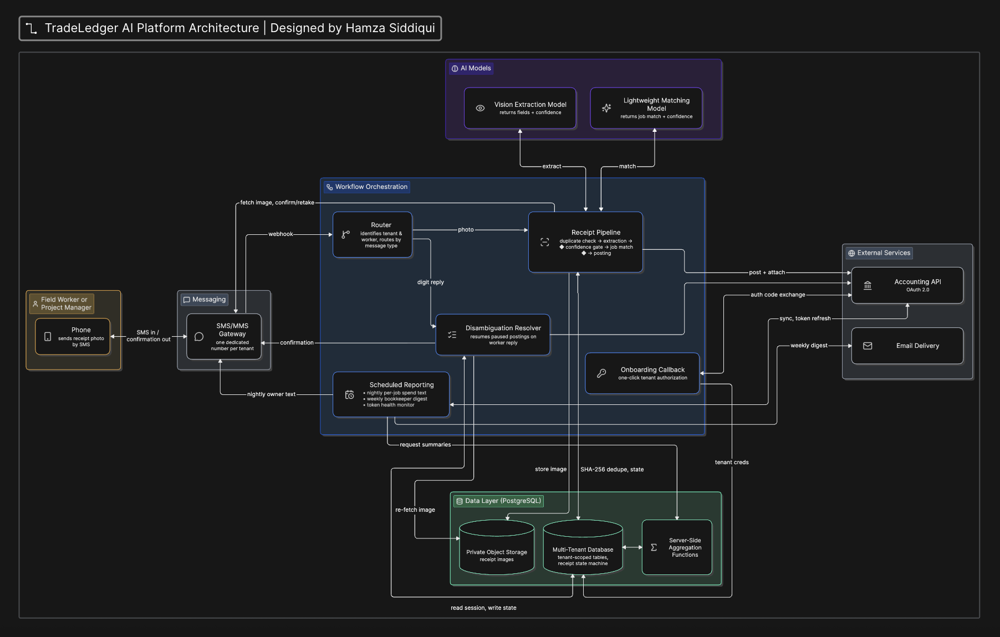

# TradeLedger AI - System Architecture

TradeLedger AI is a B2B SaaS platform that automates SMS-based receipt capture and financial intelligence for specialty trade contractors. 

This repository contains the high-level system architecture and the sanitized multi-tenant database schema that powers the application.

## Tech Stack

## System Architecture
The platform is built on an event-driven, Hub-and-Spoke model to handle asynchronous SMS webhooks, multi-model AI extraction, and human-in-the-loop disambiguation.

## Core Extraction Pipeline
While this repository focuses on the database architecture, the platform's orchestration relies on:
1. **Inbound Webhooks:** Capturing SMS MMS payloads from field workers.
2. **Vision Extraction:** Passing receipt images to an LLM for structured JSON output (Vendor, Amount, Tax, Date).
3. **Fuzzy Matching:** Comparing LLM output against synced QuickBooks project aliases.
4. **Idempotent Posting:** Writing to the PostgreSQL schema and calling the QuickBooks OAuth 2.0 API.

## Database Design Constraints
The PostgreSQL database is designed for strict data integrity and tenant isolation:
*   **Idempotent Ingestion:** The `receipts` table utilizes SHA-256 image hashes and composite unique constraints to silently drop duplicate webhook deliveries.
*   **Multi-Tenancy:** All operational tables strictly reference the `tenants` table with cascading deletes and Row-Level Security (RLS) enabled.
*   **State Management:** Receipts transition through a strict 10-state lifecycle (from `received` to `posted`) enforced by constraints to ensure no orphaned transactions.

*Note: Vendor-specific IDs, OAuth credential columns, and proprietary RPC aggregation functions have been redacted from the public schema.*
